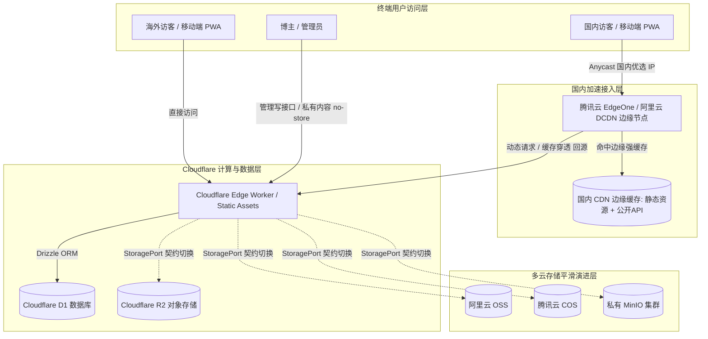
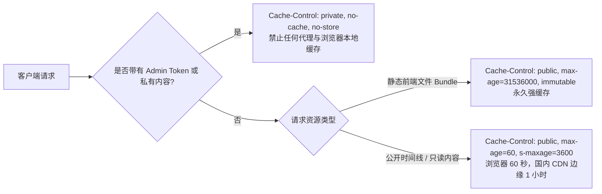

# Personal Archive 部署与国内 CDN 加速权威指南

> **文档状态**：已验证交付（M6-1 基线）  
> **适用版本**：Personal Archive v0.1.0+  
> **核心目标**：提供从 Cloudflare 全栈 Serverless 部署、国内双 CDN（腾讯云 EdgeOne / 阿里云 DCDN）前置反代加速、到多对象存储（Aliyun OSS / Tencent COS / MinIO）无缝平滑切换与标准 HTTP 缓存控制的完整生产级落地指南。

---

## 1. 架构总览与网络拓扑

Personal Archive 采用现代解耦的 Edge Serverless 架构，底层计算与存储通过接口契约（`StoragePort`、`CommentPort`）完全抽象，既能原生运行在 Cloudflare 全球边缘网络，也能通过国内顶级 CDN 与国内对象存储提供毫秒级低延迟访问。



---

## 2. Cloudflare 全栈部署配置

系统前端 SPA/PWA 与后端 API 统一通过 Cloudflare Workers 进行托管，前端通过 Workers Static Assets 托管，后端为运行在同一域或子路由上的 Hono Worker。

### 2.1 配置文件 `workers/api/wrangler.jsonc`

```jsonc
{
  "$schema": "node_modules/wrangler/config-schema.json",
  "name": "personal-archive-api",
  "main": "src/index.ts",
  "compatibility_date": "2026-02-01",
  "compatibility_flags": ["nodejs_compat"],
  // 静态前端资源托管 (Vue 3 + Vite 构建输出目录)
  "assets": {
    "directory": "../../apps/web/dist",
    "binding": "ASSETS",
    "html_handling": "single-page-application",
    "not_found_handling": "single-page-application"
  },
  // Cloudflare D1 关系型数据库绑定
  "d1_databases": [
    {
      "binding": "DB",
      "database_name": "personal-archive-prod",
      "database_id": "YOUR_D1_DATABASE_ID_HERE"
    }
  ],
  // 生产环境公共变量
  "vars": {
    "ENVIRONMENT": "production",
    "R2_BUCKET_NAME": "personal-archive-media",
    "R2_PUBLIC_DOMAIN": "https://media.yourdomain.com",
    "ADMIN_EMAIL": "admin@yourdomain.com"
  }
}
```

### 2.2 D1 数据库初始化与迁移

```bash
# 1. 登录 Cloudflare 账号
pnpm exec wrangler login

# 2. 创建生产 D1 数据库
pnpm exec wrangler d1 create personal-archive-prod
# 记录输出中的 database_id 并填入 wrangler.jsonc

# 3. 执行 Drizzle 迁移应用数据表结构
pnpm exec wrangler d1 execute personal-archive-prod --file=packages/database/drizzle/migrations/0000_init.sql

# 4. 执行初始化种子数据（创建管理员账号与预设标签）
pnpm exec tsx packages/database/src/seed.ts
```

### 2.3 R2 存储桶创建与 S3 API 密钥生成

1. **创建 R2 存储桶**：
   ```bash
   pnpm exec wrangler r2 bucket create personal-archive-media
   ```
2. **生成 S3 兼容访问凭据**：
   - 登录 Cloudflare Dashboard -> **R2 Object Storage** -> **Manage R2 API Tokens**；
   - 点击 **Create API Token**，权限选择 **Object Read & Write**，指定作用桶为 `personal-archive-media`；
   - 获取 `Access Key ID`、`Secret Access Key` 以及 `Account ID`；
   - S3 端点为：`https://<ACCOUNT_ID>.r2.cloudflarestorage.com`。

3. **配置 Workers 运行时机密环境变量（Secrets）**：
   ```bash
   pnpm exec wrangler secret put JWT_SECRET
   pnpm exec wrangler secret put ADMIN_PASSWORD
   pnpm exec wrangler secret put R2_ACCOUNT_ID
   pnpm exec wrangler secret put R2_ACCESS_KEY_ID
   pnpm exec wrangler secret put R2_SECRET_ACCESS_KEY
   ```

4. **一键构建与部署**：
   ```bash
   # 根目录下构建前端与依赖包
   pnpm build
   # 部署 Worker
   pnpm --filter @archive/api deploy
   ```

---

## 3. 国内 CDN 加速方案（腾讯云 EdgeOne / 阿里云 DCDN）

Cloudflare Anycast 节点在境外访问极快，但在国内部分省份可能存在骨干网抖动或 DNS 绕行。通过国内顶级边缘计算与安全加速平台（**腾讯云 EdgeOne** 或 **阿里云 DCDN**）作为前置反向代理节点，可实现：
- 国内 Anycast 节点 20ms 内极速首包响应；
- 动静分离：前端 SPA 静态骨架与媒体资源由国内 CDN 强缓存；
- 动态 API 协议优化：HTTP/3、TCP 边缘单边加速，回源 Cloudflare。

### 3.1 方案 A：腾讯云 EdgeOne 配置实战（推荐）

#### 步骤 1：添加站点与域名
1. 登录 [腾讯云 EdgeOne 控制台](https://console.cloudcloud.com/edgeone)；
2. 添加你的自定义域名（例如 `gallery.yourdomain.com`），解析类型选择 **CNAME 接入**。

#### 步骤 2：源站配置（指向 Cloudflare Worker）
- **源站类型**：选择 **外网域名 (FQDN)**；
- **源站地址**：填写 Cloudflare 分配的 Worker 域名（如 `personal-archive-api.yoursubdomain.workers.dev`）或在 Cloudflare 上绑定的海外解析域名；
- **回源 Host 标头（重要）**：必须设置为 Cloudflare 端绑定的真实 Host，例如 `personal-archive-api.yoursubdomain.workers.dev`；
- **回源协议**：强制 **HTTPS**，回源端口选择 **443**；
- **回源 SNI（重要）**：开启并保持与回源 Host 一致，确保 TLS 握手成功。

#### 步骤 3：边缘缓存规则与动静分离配置
在 EdgeOne **规则引擎** 中配置 3 条匹配规则：

| 优先级 | 匹配条件 | 缓存行为 | 边缘缓存 TTL | 浏览器缓存 TTL | 说明 |
| :---: | :--- | :---: | :---: | :---: | :--- |
| **1** | 路径匹配 `/api/v1/auth/*` 或 `/api/v1/*/upload-url` 或 `/api/v1/*/confirm` | **不缓存** | 0 秒 | 0 秒 (no-store) | 认证与写接口绝对透传 |
| **2** | 路径匹配 `/assets/*` 或 文件后缀为 `js,css,woff2,webp,png,svg,ico` | **强缓存** | 30 天 | 30 天 | 静态文件含 Hash，永久缓存 |
| **3** | 请求方法为 `GET` 且 路径匹配 `/api/v1/entries*` 或 `/api/v1/tags*` | **遵循源站** | 遵循 `s-maxage` (1小时) | 遵循 `max-age` (60秒) | 公开时间线只读缓存 |

#### 步骤 4：WebSocket 与 HTTPS 设置
- **HTTPS 证书**：申请免费的腾讯云 TrustAsia SSL 证书或上传自有证书，开启 **强制 HTTPS** 与 **HTTP/2 / HTTP/3** 支持；
- **WebSocket**：开启 WebSocket 支持，允许长连接透传。

---

### 3.2 方案 B：阿里云 DCDN（全站加速）配置实战

1. **添加域名**：登录阿里云 DCDN 控制台，添加加速域名 `gallery.yourdomain.com`，业务类型选择 **全站加速**；
2. **源站信息**：
   - 类型：**源站域名**；
   - 域名：Cloudflare Worker 提供的公网源站域名；
   - 端口：443（HTTPS）；
3. **回源 HTTP 头**：
   - 新增回源 Host：`Host: <Cloudflare源站域名>`；
4. **动静态加速规则**：
   - 静态内容（`*.js`, `*.css`, `*.webp`, `*.jpg`）：加速策略为 **边缘静态缓存**，TTL 设置 30 天；
   - 动态内容（`/api/*`）：由阿里云智能路由回源 Cloudflare，采用最优传输线路。

---

## 4. 多对象存储平滑切换手册（基于 `StoragePort`）

系统的媒体与附件上传通过 `@archive/contracts` 的 `StoragePort` 接口与具体供应商完全解耦。

### 4.1 架构抽象核心契约

```typescript
export interface StoragePort {
  // 生成直传 PUT 预签名凭证（浏览器直接上传至存储桶，不消耗 Worker 流量与内存）
  generateUploadUrl(key: string, contentType: string, maxSizeBytes: number): Promise<StorageUploadResult>;
  // 获取临时下载链接
  getDownloadUrl(key: string, expiresInSeconds?: number): Promise<string>;
  // 删除存储对象
  deleteObject(key: string): Promise<void>;
  // 检查对象元信息
  headObject?(key: string): Promise<StorageObjectMetadata | null>;
}
```

内置的 `R2StorageAdapter` 基于标准 S3 协议与 `aws4fetch` 实现，天然兼容所有遵循 AWS SigV4 规范的国内外对象存储服务。切换存储提供商时，**业务代码 0 修改**，仅需调整环境变量！

### 4.2 存储供应商配置对照表

| 配置参数 | Cloudflare R2 | 阿里云 OSS | 腾讯云 COS | 私有 MinIO |
| :--- | :--- | :--- | :--- | :--- |
| **`R2_ENDPOINT`** | *(可不填，自动由 accountId 生成)* | `https://archive.oss-cn-beijing.aliyuncs.com` | `https://archive.cos.ap-shanghai.myqcloud.com` | `https://minio.yourlan.com:9000` |
| **`R2_REGION`** | `auto` | `oss-cn-beijing` | `ap-shanghai` | `us-east-1` *(默认)* |
| **`R2_BUCKET_NAME`** | `personal-archive-media` | `archive` | `archive` | `personal-archive` |
| **`R2_ACCESS_KEY_ID`**| Cloudflare R2 Access Key | 阿里云 RAM 用户 AccessKey ID | 腾讯云 API 密钥 SecretId | MinIO Root/User Access Key |
| **`R2_SECRET_ACCESS_KEY`**| Cloudflare R2 Secret Key | 阿里云 RAM 用户 AccessKey Secret| 腾讯云 API 密钥 SecretKey | MinIO Secret Key |
| **`R2_PUBLIC_DOMAIN`**| `https://media.yourdomain.com` | `https://cdn.yourdomain.com` *(国内CDN)* | `https://cdn.yourdomain.com` *(国内CDN)* | `https://assets.yourlan.com` |

### 4.3 切换至阿里云 OSS 示例

1. **阿里云 OSS 控制台配置**：
   - 创建 Bucket，选择地域（如 `oss-cn-beijing`），读写权限推荐设为 **私有** 或 **公共读**；
   - 在 **Bucket 跨域设置 (CORS)** 中添加规则：
     - 来源：`*` 或你的博客前端域名；
     - 允许 Methods：`PUT, GET, HEAD, OPTIONS`；
     - 允许 Headers：`*`，暴露 Headers：`ETag, Content-Length`；
   - 绑定国内 CDN 域名（如 `https://cdn.yourdomain.com`）到该 Bucket。

2. **更新 Worker 环境变量**：
   ```bash
   pnpm exec wrangler secret put R2_ENDPOINT
   # 输入: https://archive.oss-cn-beijing.aliyuncs.com

   pnpm exec wrangler secret put R2_REGION
   # 输入: oss-cn-beijing

   pnpm exec wrangler secret put R2_ACCESS_KEY_ID
   # 输入阿里云 RAM AccessKeyId

   pnpm exec wrangler secret put R2_SECRET_ACCESS_KEY
   # 输入阿里云 RAM AccessKeySecret

   pnpm exec wrangler secret put R2_PUBLIC_DOMAIN
   # 输入加速域名: https://cdn.yourdomain.com
   ```

### 4.4 切换至腾讯云 COS 示例

1. **腾讯云 COS 控制台配置**：
   - 创建存储桶（如 `archive`，所属地域 `ap-shanghai`）；
   - 在 **安全管理 -> 跨域访问 (CORS)** 中允许前端域名的 `PUT, GET, HEAD` 请求，并放行 `Content-Type` 标头；
   - 在 **自定义 CDN 加速域名** 中关联加速域名（如 `https://cdn.yourdomain.com`）。

2. **更新 Worker 环境变量**：
   ```bash
   pnpm exec wrangler secret put R2_ENDPOINT
   # 输入: https://archive.cos.ap-shanghai.myqcloud.com
   pnpm exec wrangler secret put R2_REGION
   # 输入: ap-shanghai
   pnpm exec wrangler secret put R2_PUBLIC_DOMAIN
   # 输入: https://cdn.yourdomain.com
   ```

---

## 5. HTTP 缓存控制规范（Cache-Control Specifications）

系统严格执行**安全、可预测、边缘友好**的 HTTP 缓存分级规范：



### 5.1 详细响应标头规范对照

| 接口 / 资源分类 | 示例路径 | `Cache-Control` 标头值 | 设计说明 |
| :--- | :--- | :--- | :--- |
| **公开时间线 Feed** | `GET /api/v1/entries?limit=20` | `public, max-age=60, s-maxage=3600` | 浏览器本地缓存 1 分钟避免重复发刷；国内 CDN 边缘缓存 1 小时保证秒开。 |
| **公开条目详情** | `GET /api/v1/entries/:id` | `public, max-age=60, s-maxage=3600` | 访客只读内容由边缘节点就近响应，回源率降低 95% 以上。 |
| **公开标签字典** | `GET /api/v1/tags` | `public, max-age=300, s-maxage=86400` | 标签变更频率极低，边缘缓存 24 小时。 |
| **静态前端 Assets** | `/assets/index-B_91a.js` | `public, max-age=31536000, immutable` | Vite 构建自带内容 Hash，永久强缓存，永不过期。 |
| **HTML 页面入口** | `/index.html` | `public, max-age=0, must-revalidate` | 每次必须与源站 ETag 协商验证，确保发布即生效。 |
| **管理后台写接口** | `POST/PUT/DELETE /api/v1/*` | `private, no-cache, no-store, must-revalidate` | 涉及数据变更，严禁任何中间缓存。 |
| **私有条目/认证** | `GET /api/v1/entries/:id` *(带Token)* | `private, no-cache, no-store` | 用户携带有效管理员 Token 时，即使查询公开接口也自动降级为私有不缓存，确保看到最新数据。 |

### 5.2 CDN 缓存主动失效（Purge）建议

当博主通过管理员权限发布或更新文章时，可采取以下失效策略：
1. **天然过期**：公开接口边缘 TTL 仅设为 3600s（1小时），正常情况下 1 小时内全网自动平滑同步；
2. **主动刷新（可选）**：通过腾讯云 EdgeOne / 阿里云 DCDN OpenAPI 触发指定路径刷新：
   - 路径：`https://gallery.yourdomain.com/api/v1/entries*`
   - 类型：目录或 URL 刷新。
